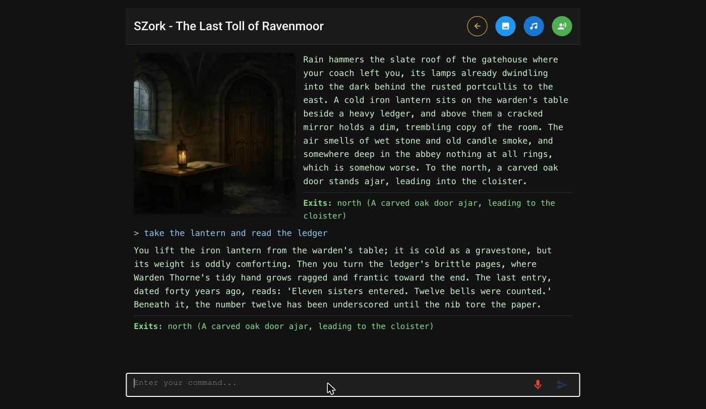
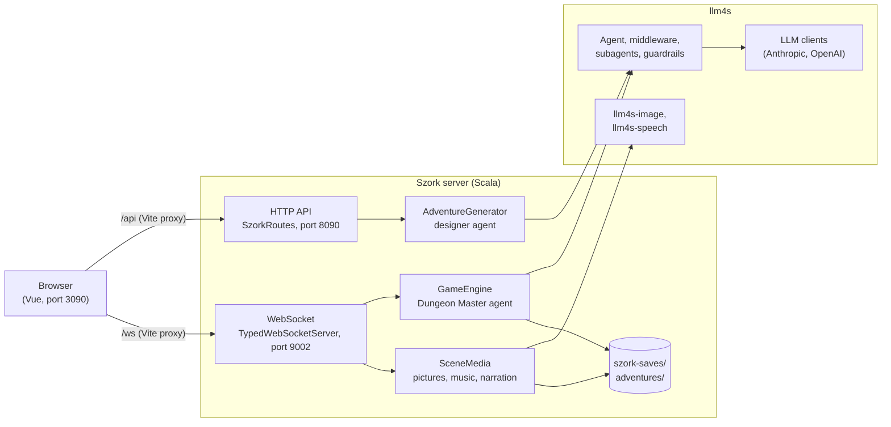

# Szork

Szork is a text adventure whose Dungeon Master is an AI agent. You type (or say) what you do; the Dungeon Master
answers with the next scene, keeps track of the world, and the game draws each place and plays music for its mood.

It exists to show how to build an application with [llm4s](https://github.com/llm4s/llm4s), the Scala library for
LLMs. In about 11,000 lines of Scala it uses llm4s's agents and threads, structured output with checks of its own,
tools, middleware, typed subagents, input guardrails, image generation, speech, tracing and the testkit. Each is used
for something the game needs, and [docs/LLM4S_FEATURES.md](docs/LLM4S_FEATURES.md) is a guided tour of where.



## Quick start

You need:

- Java 21 or later
- sbt 1.12 or later (it fetches Scala 3)
- Node.js 22.13 or later (`.nvmrc` names 22)
- curl, for `./dev.sh`
- an API key for Anthropic or OpenAI (see [What each key gives you](#what-each-key-gives-you))

```bash
git clone https://github.com/llm4s/szork.git
cd szork
cp .env.example .env
# edit .env: uncomment ANTHROPIC_API_KEY or OPENAI_API_KEY and put your key in it
```

Then start the server and the frontend with one command:

```bash
./dev.sh
```

It checks for Java, sbt, Node, curl and `.env`, installs the frontend's packages the first time, refuses to start if
port 8090, 9002 or 3090 is already in use, waits for the server (the first build downloads and compiles for some
minutes) and prints `Open http://localhost:3090`. Ctrl+C stops both; their logs are in `backend.log` and
`frontend.log`. It runs the server in watch mode, so it restarts when a Scala file changes.

To run the two yourself instead, start the game server in one terminal:

```bash
sbt szorkStart
```

The log lists the configuration, which features are available (and why any are not), and ends with
`Szork server started on http://127.0.0.1:8090`. The server does not start without an LLM key, with an unknown
`SZORK_LLM_PROVIDER` or `SZORK_REASONING_EFFORT`, or with a port it cannot use (out of range, or the WebSocket port
equal to the HTTP port); the log says which.

Start the browser frontend in a second terminal:

```bash
cd frontend
npm install
npm run dev
```

Open http://localhost:3090. The frontend is the only way to play: the server has no page of its own to play on. Choose
**Begin Your Adventure**, then one of the **Ready-Made Adventures** to play at once, or **Start New Adventure** to
have one designed for a theme you choose (that takes a minute or so).

## What each key gives you

Keys go in `.env` (or the environment). Only an LLM is required.

| You set | What you get |
|---|---|
| no LLM key | Nothing: the server exits at startup and says so |
| `ANTHROPIC_API_KEY` | The whole game on Claude (`claude-sonnet-5-5` unless `SZORK_LLM_MODEL` says otherwise). No narration or voice input, which need OpenAI |
| `OPENAI_API_KEY` | The whole game on `gpt-6-luna`, with spoken narration (OpenAI TTS) and voice input (Whisper). Scene pictures too, if you set `SZORK_IMAGE_PROVIDER=openai` |
| both | The Dungeon Master on OpenAI (set `SZORK_LLM_PROVIDER=anthropic` to use Claude), narration and voice input on OpenAI |
| `REPLICATE_API_KEY` as well | New music tracks made with MusicGen, for a mood the library has no track for |

Two things are true whatever you set:

- **New pictures are off by default.** `SZORK_IMAGE_PROVIDER` is `none` until you choose a provider (`openai` for GPT
  Image, or HuggingFace or a local Stable Diffusion server; see [Configuration](#configuration)).
- **The three ready-made adventures have their pictures, and the library has a music track for every mood**, in
  `adventures/`. So their pictures show, and every game plays music, with no image or music provider at all. A designed
  adventure shows pictures only with an image provider.

`GET http://localhost:8090/api/feature-flags` shows what the running server can provide.

## How it works



The browser talks to the server two ways, both through the Vite dev server's proxy, so the page sees one origin:

- **HTTP** (`/api`, port 8090): the features available, the saved games and the ready-made adventures, checking a
  custom theme, and designing an adventure. [frontend/README.md](frontend/README.md) lists the routes.
- **WebSocket** (`/ws`, port 9002): the game itself. A new or loaded game, each command, the narration as it is
  written, and the pictures and music when they are ready. A browser that reconnects resumes its game; a game whose
  session has expired is loaded again from its save. The messages are defined in
  [`WebSocketProtocol.scala`](src/main/scala/org/llm4s/szork/websocket/protocol/WebSocketProtocol.scala) and mirrored in
  [`WebSocketProtocol.ts`](frontend/src/types/WebSocketProtocol.ts).

A new adventure is designed by one agent (`AdventureGenerator`): it answers with an outline, its locations and their
exits, items, characters, puzzles and quests, in a schema llm4s holds it to. The outline goes into the Dungeon Master's
system prompt, and seeds the game's world state.

### How a turn works

A game is one llm4s agent thread, and each command is the next turn on it.

1. The browser sends the command. The server refuses one longer than 1000 characters, or one beyond three turns
   already running or waiting, and otherwise queues it on the game's session, which runs one task at a time.
2. llm4s's `GuardrailMiddleware` checks the command for prompt injection (`PlayerInputGuardrail`). A refused command
   never reaches the model; the player is told "The dungeon does not understand you." and nothing changes.
3. Every model call of the turn is sent the system prompt (the rules and the adventure outline), a prompt section with
   the current game state (location, exits, inventory, quests; `WorldStateMiddleware`), and as much of the recent
   conversation as fits the context window (llm4s's `ContextWindowMiddleware`). The thread itself keeps the whole game.
4. The Dungeon Master may call tools: the inventory, and the world state (exit states, location flags, characters met,
   quest progress). It may also delegate to two subagents, one that voices a character and one that writes a hint. A
   tool call repeated with nothing changed since is not run again, and after a turn's first three model calls the model
   is offered no tools, so it answers (`RepeatedToolCalls.scala`). A turn has at most twelve model calls.
5. The answer is a JSON object in the schema derived from `DungeonMasterOutput.Answer`: either a full scene (a new
   place, or a look around) or a simple response. llm4s checks it against the schema and against the game's own rules
   (`GameResponseValidator`, via `withOutputCheck`), and asks the model once to correct an answer that fails.
6. A scene that would move the player through an exit that is not open goes back to the model once, with what is in
   the way (`ExitGuardMiddleware`); if the model insists, the player is told the way is shut.
7. The narration streams to the browser as the model writes it, read from the partial JSON with llm4s's `PartialJson`.
8. A turn is whole or nothing. One that fails or ends at a limit leaves the conversation, inventory and world as they
   were, and the player is told to send the command again.
9. A completed turn is saved as a step under `szork-saves/<game-id>/`. Then, on their own thread pools, the picture of
   a new place is drawn (or the one it already has is sent) and the music for its mood is sent.

### Code layout

```
src/main/scala/org/llm4s/szork/
├── api/          SzorkServer (main), SzorkApp (the server), SzorkRoutes (HTTP API), SzorkConfig and its parts,
│                 EngineFactory, sessions, capabilities, tracing, theme validation, themes and art styles
├── config/       EnvLoader: reads .env and the environment
├── websocket/    TypedWebSocketServer (all gameplay) and the protocol
├── game/         GameEngine and DmConversation (the Dungeon Master), its output schema, tools, middleware and
│                 subagents, the world state, the designer and art director agents, prompts
├── adventures/   AdventureLibrary (ready-made adventures and their media) and the BakeAdventure command
├── media/        Pictures, music, narration, voice input and the media cache
├── persistence/  Step-based saves
├── streaming/    The narration read from a streamed answer
├── playtest/     A whole adventure designed, played and checked against a real model
├── spi/, adapters/  The media clients behind traits that tests replace
├── error/        SzorkError and the messages the player sees
└── tools/        GenerateStyleSamples
frontend/         Vue 3, Vuetify 3, TypeScript
adventures/       The ready-made adventures, their pictures, and a music track per mood
```

[CLAUDE.md](CLAUDE.md) describes each part in more detail.

## Configuration

Set these in `.env` (copy [.env.example](.env.example)) or in the environment; a variable set in the environment wins
over `.env`. The server reads `.env` from its working directory, or failing that from the directory above. A blank
value counts as not set. A flag (a setting whose default is `true`) is on unless set to `false`, `off`, `0` or `no`, in
any case. A number that does not parse is ignored.

| Variable | Default | Purpose |
|---|---|---|
| `ANTHROPIC_API_KEY`, `OPENAI_API_KEY` | – | LLM provider keys. OpenAI's also gives narration, voice input and GPT Image pictures |
| `LLAMA_BASE_URL` | `http://localhost:11434/v1` | An OpenAI-compatible server for `SZORK_LLM_PROVIDER=llama` (or `local`), used as given, so it ends in `/v1`; no key needed |
| `ANTHROPIC_BASE_URL`, `OPENAI_BASE_URL` | `https://api.anthropic.com`, `https://api.openai.com/v1` | Send the agents' calls elsewhere (a proxy or a compatible server); pictures, narration and Whisper still use OpenAI's own |
| `SZORK_LLM_PROVIDER` | the first key present: OpenAI, Anthropic, then `LLAMA_BASE_URL` | `openai`, `anthropic` or `llama`; anything else stops the server |
| `SZORK_LLM_MODEL` | `gpt-6-luna`, `claude-sonnet-5-5`, `llama3` | The model for the designer, the Dungeon Master and (unless `SZORK_SUBAGENT_MODEL`) its subagents; see [Models](#models) |
| `SZORK_REASONING_EFFORT` | `low` | How hard a model that reasons does so: `minimal`, `low`, `medium`, `high`, `xhigh`, `max`, or `default` (also `off`, `none`) to leave it to the model. Not sent to a model that does not reason. Anything else stops the server. The Claude 5 models reason at `high` unless told otherwise, which is slow and can use up the whole answer |
| `SZORK_DM_CONTEXT_MAX_TOKENS` | `24000` | Conversation tokens sent with each Dungeon Master call, besides the system prompt (oldest turns dropped first; capped at half the model's context window; `0` or `off` sends the whole game) |
| `SZORK_DM_CONTEXT_MAX_MESSAGES` | – | Limit each call by conversation messages instead of tokens |
| `SZORK_INPUT_GUARDRAIL` | `true` | Check each command with llm4s's prompt-injection guardrail before the model sees it |
| `SZORK_NPC_AGENT`, `SZORK_HINT_AGENT` | `true`, `true` | The Dungeon Master's subagents: one voices a character, one writes a hint. Each costs one small model call, and one more Dungeon Master call to use its report, only on the turns that use it |
| `SZORK_SUBAGENT_MODEL` | the Dungeon Master's model | A cheaper or faster model of the same provider for the subagents (e.g. `claude-haiku-5-5`, or `gpt-4o-mini` on OpenAI) |
| `SZORK_HOST`, `SZORK_PORT`, `SZORK_WS_PORT` | `127.0.0.1`, `8090`, `9002` | Where the HTTP and WebSocket servers listen. The server warns at startup when `SZORK_HOST` is not a loopback address: Szork has no login, and anyone who reaches it plays on your keys |
| `SZORK_ALLOWED_ORIGINS` | `http://localhost:3090`, `http://127.0.0.1:3090`, and the same two on `SZORK_PORT` | Browser origins allowed to open the WebSocket and call the HTTP API (comma-separated). A page served from anywhere else must be added here |
| `SZORK_ALLOWED_HOSTS` | – | Names (`name` or `name:port`, comma-separated) the HTTP API answers to besides `localhost`, `127.0.0.1`, `[::1]` and `SZORK_HOST` on `SZORK_PORT`; a request with another `Host` is refused, which defeats DNS rebinding. Set it when the server is reached by another name (a reverse proxy that passes its own `Host`). With `SZORK_HOST=0.0.0.0` the `Host` is checked only if this is set |
| `SZORK_SESSION_TTL_MINUTES` | `30` | How long a game's session lives with no connection: a browser that reconnects within it carries on; after it the game is loaded from its save |
| `SZORK_IMAGE_GENERATION_ENABLED` | `true` | Pictures at all, including the library's |
| `SZORK_IMAGE_PROVIDER` | `none` | Who draws new pictures: `openai` (GPT Image), `dalle3`, `dalle2`, `huggingface`, `huggingface-sdxl` or `local` (Stable Diffusion). An unknown value counts as `none`. Image calls are traced with the Dungeon Master |
| `SZORK_IMAGE_MODEL` | the provider's default (`gpt-image-1-mini` for `openai`) | Another of the provider's models |
| `SZORK_IMAGE_QUALITY`, `SZORK_IMAGE_PIXELS` | `low`, `1024` | How well GPT Image models draw (`low`, `medium`, `high`, `auto`: cost and time rise steeply), and the longer side, in pixels, pictures are kept and sent at (as JPEG) |
| `HUGGINGFACE_API_KEY` (or `HF_API_KEY`, `HUGGINGFACE_TOKEN`) | – | Key for the `huggingface` providers |
| `STABLE_DIFFUSION_URL` (or `SD_URL`), `STABLE_DIFFUSION_API_KEY` (or `SD_API_KEY`) | `http://localhost:7860`, – | The `local` Stable Diffusion server |
| `SZORK_TTS_ENABLED`, `SZORK_TTS_VOICE`, `SZORK_TTS_MODEL` | `true`, `nova`, `tts-1` | Narration (needs `OPENAI_API_KEY`) |
| `SZORK_STT_ENABLED`, `SZORK_STT_MODEL` | `true`, `whisper-1` | Voice input (needs `OPENAI_API_KEY`) |
| `SZORK_MUSIC_ENABLED`, `REPLICATE_API_KEY` | `true`, – | Background music: the library's tracks, and new ones made on Replicate |
| `SZORK_MUSIC_POLL_MAX_ATTEMPTS`, `SZORK_MUSIC_POLL_INTERVAL_MS` | `30`, `1000` | How long to wait for a new track (polls, and the time between them) |
| `SZORK_MEDIA_CONNECT_TIMEOUT_MS`, `SZORK_MEDIA_READ_TIMEOUT_MS` | `10000`, `30000` | Network timeouts for Replicate |
| `SZORK_AUTO_SAVE`, `SZORK_SAVES_DIR` | `true`, `szork-saves` | Saving each turn |
| `SZORK_ADVENTURES_DIR` | `adventures` | The adventure library ([docs/ADVENTURES.md](docs/ADVENTURES.md)) |
| `SZORK_CACHE_ENABLED`, `SZORK_CACHE_DIR`, `SZORK_CACHE_MAX_BYTES`, `SZORK_CACHE_TTL_MS` | `true`, `szork-cache`, 500 MB, 7 days | The cache of pictures made for one game |
| `TRACING_MODE` (with `LANGFUSE_PUBLIC_KEY`, `LANGFUSE_SECRET_KEY`, `LANGFUSE_URL`) | off | Trace the agents and image calls: `console` or `langfuse` |

What a client may send is bounded by fixed limits in `SzorkConfig`: a command of 1000 characters, a recording of
10 MB, a theme of 2000 characters, an adventure outline of 256 KB, an HTTP body of 1 MB, a WebSocket message of
16 MB, and three turns running or waiting per game.

The frontend connects its WebSocket to `/ws` on the page's own origin, which the Vite dev server proxies to port 9002.
Set `VITE_WS_URL` (for example `ws://localhost:9002`) to connect elsewhere.

### Models

The defaults, `claude-sonnet-5-5` and `gpt-6-luna`, each designed an adventure and played a 20-turn live playtest with
no hard finding on 2026-11-26. Earlier playtests, at the default reasoning effort (`low`), found:

| Model | Result |
|---|---|
| `claude-sonnet-5-5` | Works: designed an adventure in one call and played 30 turns with no finding, about 3.5 s a turn |
| `claude-haiku-5-5` | Works: 20 turns with no rule broken, about 2.7 s a turn; its first outline needed llm4s's one correction |
| `claude-sonnet-4-6` | Works: 12 turns with no finding, but about 11 s a turn, because `low` turns its extended thinking on. Set `SZORK_REASONING_EFFORT=default` to play it without |
| `gpt-6-luna` | Works: designed an adventure and played 16 turns with no finding, about 3.7 s a turn. It plays with reasoning off: OpenAI's Chat Completions API lets its current models call tools only that way, and llm4s switches it off for this model |
| `gpt-6.1-terra`, `gpt-5.6-terra`, `gpt-5.6-luna` | Do not work on llm4s 1.0.0: it refuses tools on `gpt-6.1-terra`, and sends the `gpt-5.6` models a reasoning effort OpenAI rejects with tools |

To check a model, run a playtest on it: `SZORK_LLM_MODEL=<model> sbt "runMain org.llm4s.szork.playtest.Playtest"`
([docs/TESTING.md](docs/TESTING.md)).

## Development

```bash
sbt "~szorkStart"    # the server, restarted when a Scala file changes
sbt szorkStop        # also szorkRestart, szorkStatus
sbt test             # backend tests: scripted models, no network
cd frontend && npm test
sbt "runMain org.llm4s.szork.playtest.Playtest"   # design and play a whole adventure on the configured model
```

To play from the command line, or to see how a model plays, run the playtest: it designs an adventure (or takes one
from the library with `--adventure <id>`), plays it with a model as the player, and prints every turn.

- [CONTRIBUTING.md](CONTRIBUTING.md): building, testing, commit sign-off and style
- [docs/LLM4S_FEATURES.md](docs/LLM4S_FEATURES.md): a guided tour of llm4s in Szork
- [docs/TESTING.md](docs/TESTING.md): the test layers and the playtest
- [docs/ADVENTURES.md](docs/ADVENTURES.md): the adventure library and baking its media
- [docs/README_DEVELOPMENT.md](docs/README_DEVELOPMENT.md): hot reload and IDE setup
- [frontend/README.md](frontend/README.md): the frontend
- [CLAUDE.md](CLAUDE.md): the architecture in detail, for people and coding agents

## Troubleshooting

- **The server exits at startup**: the log's last lines say why: no LLM key, an unknown `SZORK_LLM_PROVIDER` or
  `SZORK_REASONING_EFFORT`, or an unusable port.
- **"The AI service rejected the server's API key"**: the key in `.env` is missing, mistyped, or for another provider
  than the one in use.
- **"The AI service rejected the request; the configured model may not be supported"**: the provider refused the
  request (often a parameter the model does not take). Set `SZORK_LLM_MODEL` to a model from the table above; the
  server log has the provider's message.
- **"The AI's adventure design came back incomplete or malformed"**: the model did not finish the outline. Try again;
  if it repeats, the model may be spending its answer on reasoning: check that `SZORK_REASONING_EFFORT` is not
  `default`, `high` or above. The server log has the outline's problem.
- **"The Dungeon Master did not finish the turn: the turn ended StepLimitReached"**: the Dungeon Master used its twelve
  model calls without answering. The game is unchanged; send the command again.
- **The game restarts while you play**: the server is in watch mode (`sbt "~szorkStart"` or `./dev.sh`) and a source
  file changed. Use `sbt szorkStart` to play.
- **"The picture could not be drawn"** and the server log says `The model 'dall-e-3' does not exist`: OpenAI no longer
  offers DALL-E on the account; set `SZORK_IMAGE_PROVIDER=openai` (GPT Image).
- **Requests refused with 403**: the page is served from an origin not in `SZORK_ALLOWED_ORIGINS`, or the server is
  reached by a name not in `SZORK_ALLOWED_HOSTS`.
- **No pictures, music or voice**: `GET /api/feature-flags` shows what the server can provide, and the startup log says
  why a feature is off.

## History

Szork was first written as the demonstration for the talk "Scala Meets GenAI: Build the Cool Stuff with LLM4S" at
[Scala Days 2025](https://scaladays.org/editions/2025/talks/scala-meets-genai-build-the); the talk material is in
[llm4s/szork-talks](https://github.com/llm4s/szork-talks). It has since been rebuilt on llm4s 1.0 as a reference for
the library.

Contributors: [Rory Graves](https://github.com/rorygraves) and [Kannupriya Kalra](https://github.com/kannupriyakalra).

## Licence

Apache License 2.0; see [LICENSE](LICENSE).
